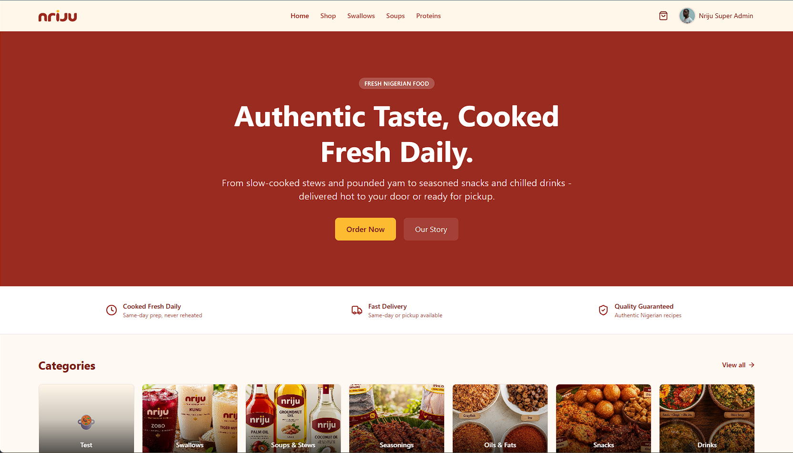
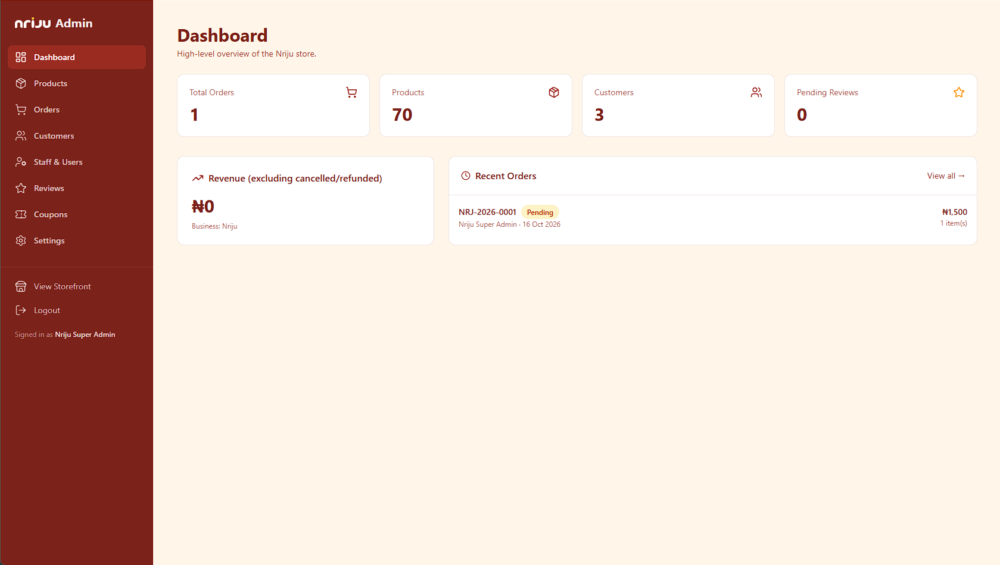

# Nriju


[](#tech-stack)

Nriju is a full‑stack e‑commerce platform for a Nigerian prepared & cooked food store. It gives the entire storefront journey (browsing, cart, checkout, payment, orders, reviews, wishlists) and an admin dashboard that manages products, orders, customers, coupons, inventory, reviews, notifications and settings.

| Property       | Details                                                       |
| -------------- | ------------------------------------------------------------- |
| **Product**    | Nigerian meals, soups, swallows, proteins & snacks            |
| **Type**       | Full‑stack SPA + REST API                                     |
| **Frontend**   | React 19, Vite, Tailwind v4, Redux Toolkit, TanStack Query    |
| **Backend**    | Node.js, Express, MongoDB, Mongoose                           |
| **API prefix** | /api/v1                                                       |
| **Auth**       | JWT cookies, Google OAuth, email verification, password reset |
| **Payments**   | Paystack                                                      |
| **Email**      | Brevo                                                         |
| **Media**      | Cloudinary                                                    |
| **Production** | Express serves client/dist as a single‑origin SPA             |

> **Read this first.**  
> Before shipping, review the [Known Route‑Order Caveats](#known-route-order-caveats).

---

## Table of Contents

1. [Overview](#overview)
2. [Features](#features)
3. [Tech Stack](#tech-stack)
4. [Project Structure](#project-structure)
5. [Getting Started](#getting-started)
6. [Scripts](#scripts)
7. [Architecture](#architecture)
8. [API Reference](#api-reference)
9. [Deployment Guide](#deployment-guide)
10. [Environment Variables](#environment-variables)
11. [Business Rules](#business-rules)
12. [Visual Assets Guide](#visual-assets-guide)
13. [Troubleshooting](#troubleshooting)
14. [Known Route‑Order Caveats](#known-route-order-caveats)
15. [Security Notes](#security-notes)

---

## Overview

Nriju is built for perishable inventory. Money is stored as **kobo** (integer).
The backend calculates availability from active inventory batches and keeps order creation transactional, so stock deduction and order persistence stay consistent.

The frontend is a React SPA. In development Vite runs on **5173** and proxies /api to the Express backend on **5000**.
In production the same Express server serves the built SPA from client/dist, keeping cookies, OAuth callbacks and Paystack webhooks on one origin.

---

## Features

### Customer Storefront

- Browse by category, search, filters & featured items
- Product detail page – images, price, description, reviews
- Cart drawer & full cart page; quantity updates
- Checkout with delivery selection, coupon validation
- Paystack initialiser & verification
- Email/password login **or** Google OAuth
- Email verification & password‑reset flows
- Account dashboard – profile, avatar, addresses, orders, wishlist, password changes
- Static pages – About, Contact, Delivery, FAQ, Privacy, Returns, Terms

### Admin Dashboard

- Manage products, categories, inventory batches, orders, users, reviews, coupons, settings, notifications
- Upload images via Cloudinary (product & category)
- Dashboard stats & charts (Recharts)
- Review moderation
- Activity log inspection
- Create notifications

### Backend Services

- REST API under /api/v1
- MongoDB persistence (Mongoose schemas)
- JWT stored in an HttpOnly cookie; Authorization: Bearer fallback
- Passport Google OAuth2
- Rate limiting on sensitive auth endpoints
- Centralised error handling & activity logging
- Inventory availability from active/unexpired batches
- Transactional order creation (FIFO stock deduction)
- Brevo transactional email
- Seed script (
  pm run seed) for dev data

---

## Tech Stack

### Backend

| Technology              | Role                            |
| ----------------------- | ------------------------------- |
| Node.js                 | Runtime                         |
| Express                 | HTTP API framework              |
| MongoDB + Mongoose      | Persistence & schema validation |
| JWT                     | Stateless session tokens        |
| Passport Google OAuth2  | Social login                    |
| Multer                  | Multipart upload handling       |
| Cloudinary              | Remote image storage            |
| Brevo                   | Transactional email             |
| Paystack                | Payments                        |
| express-rate-limit      | Rate limiting                   |
| express-validator / Joi | Validation middleware           |

### Frontend

| Technology       | Role                                    |
| ---------------- | --------------------------------------- |
| React 19         | UI library                              |
| Vite             | Dev server & build tool                 |
| Tailwind v4      | Styling                                 |
| Redux Toolkit    | Client state (auth, cart, wishlist, UI) |
| TanStack Query   | Server‑state caching                    |
| React Router v7  | SPA routing                             |
| React Hook Form  | Form handling                           |
| Zod              | Schema validation                       |
| Axios            | API client                              |
| Lucide React     | Icons                                   |
| Sonner           | Toast notifications                     |
| Recharts         | Admin charts                            |
| Embla Carousel   | Carousel support                        |
| react-image-crop | Avatar cropping                         |

---

## Project Structure

```
nriju/
 ├─ Backend/
 │   ├─ config/
 │   │   ├─ cloudinary.js
 │   │   ├─ db.js
 │   │   └─ passport.js
 │   ├─ controllers/
 │   │   ├─ adminController.js
 │   │   ├─ authController.js
 │   │   ├─ cartController.js
 │   │   ├─ categoryController.js
 │   │   ├─ couponController.js
 │   │   ├─ inventoryController.js
 │   │   ├─ notificationController.js
 │   │   ├─ orderController.js
 │   │   ├─ paymentController.js
 │   │   ├─ productController.js
 │   │   ├─ reviewController.js
 │   │   ├─ settingController.js
 │   │   └─ wishlistController.js
 │   ├─ middleware/
 │   │   ├─ activityLog.js
 │   │   ├─ auth.js
 │   │   ├─ error.js
 │   │   ├─ rateLimit.js
 │   │   └─ upload.js
 │   ├─ models/
 │   │   ├─ ActivityLog.js
 │   │   ├─ Cart.js
 │   │   ├─ Category.js
 │   │   ├─ Coupon.js
 │   │   ├─ EmailVerificationToken.js
 │   │   ├─ Inventory.js
 │   │   ├─ Notification.js
 │   │   ├─ Order.js
 │   │   ├─ PasswordResetToken.js
 │   │   ├─ Payment.js
 │   │   ├─ Product.js
 │   │   ├─ Review.js
 │   │   ├─ Setting.js
 │   │   ├─ User.js
 │   │   └─ Wishlist.js
 │   ├─ routes/
 │   │   ├─ adminRoutes.js
 │   │   ├─ authRoutes.js
 │   │   ├─ cartRoutes.js
 │   │   ├─ categoryRoutes.js
 │   │   ├─ couponRoutes.js
 │   │   ├─ inventoryRoutes.js
 │   │   ├─ notificationRoutes.js
 │   │   ├─ orderRoutes.js
 │   │   ├─ paymentRoutes.js
 │   │   ├─ productRoutes.js
 │   │   ├─ reviewRoutes.js
 │   │   ├─ settingRoutes.js
 │   │   └─ wishlistRoutes.js
 │   ├─ scripts/
 │   │   ├─ addCategoryImages.js
 │   │   ├─ addImagesToSeed.js
 │   │   ├─ bulkUpload.js
 │   │   ├─ fixCategorySeed.js
 │   │   ├─ fixSeeds.js
 │   │   ├─ seed-hints.js
 │   │   └─ updateSeedsWithImages.js
 │   ├─ seed/
 │   │   ├─ categories.js
 │   │   ├─ coupons.js
 │   │   ├─ products.js
 │   │   ├─ runSeed.js
 │   │   └─ users.js
 │   ├─ services/
 │   │   ├─ emailService.js
 │   │   └─ inventoryService.js
 │   ├─ utils/
 │   │   ├─ cloudinaryUtils.js
 │   │   ├─ crypto.js
 │   │   ├─ delivery.js
 │   │   ├─ format.js
 │   │   ├─ money.js
 │   │   ├─ slugify.js
 │   │   └─ token.js
 │   └─ server.js
 ├─ client/
 │   ├─ index.html
 │   ├─ vite.config.js
 │   └─ src/
 │       ├─ App.jsx
 │       ├─ main.jsx
 │       ├─ components/
 │       │   ├─ admin/
 │       │   ├─ guards/
 │       │   ├─ layout/
 │       │   ├─ sections/
 │       │   ├─ shared/
 │       │   └─ ui/
 │       ├─ hooks/
 │       ├─ pages/
 │       │   ├─ account/
 │       │   ├─ admin/
 │       │   └─ public/
 │       ├─ services/
 │       │   ├─ api.js
 │       │   └─ queryClient.js
 │       ├─ slices/
 │       │   ├─ authSlice.js
 │       │   ├─ cartSlice.js
 │       │   ├─ uiSlice.js
 │       │   └─ wishlistSlice.js
 │       ├─ store/
 │       │   └─ store.js
 │       ├─ styles/
 │       │   └─ index.css
 │       └─ utils/
 │           ├─ formatMoney.js
 │           └─ formatTimeAgo.js
 ├─ package.json
 ├─ .env.example
 └─ README.md
```

---

## Getting Started

### Prerequisites

- **Node.js 18+** and **npm**
- MongoDB (local or Atlas)
- Cloudinary account
- Brevo account
- Paystack account
- Google OAuth credentials

### Install

```powershell
npm install
npm install --prefix client  # pulls client deps
npm run build  # installs all deps and builds the SPA into client/dist
```

### Configure

```powershell
Copy-Item .env.example .env
```

Edit the new .env with your own values (see section Environment Variables).

### Run Locally

```powershell
npm run dev
```

Backend `http://localhost:5000`

Frontend `http://localhost:5173` (Vite proxies /api)

### Seed Development Data

```powershell
npm run seed
```

---

### Scripts

| Root             | Action                               |
| ---------------- | ------------------------------------ |
| `npm start`      | Start Express server                 |
| `npm run server` | Nodemon‑started server               |
| `npm run client` | Poised Vite dev server               |
| `npm run dev`    | Runs backend + frontend concurrently |
| `npm run seed`   | Seed MongoDB (dev only)              |
| `npm run build`  | Build SPA & install deps             |

| Client            | Action             |
| ----------------- | ------------------ |
| `npm run dev`     | Vite dev server    |
| `npm run build`   | Production build   |
| `npm run lint`    | Lint (Eslint)      |
| `npm run preview` | Serve dist locally |

---

## Architecture

```bash
Browser
 └──> React SPA
          └──> Axios (client/src/services/api.js)
                └──> Vite proxy (dev) / Express server (prod)
                      └──> Express API (/api/v1)
                            ├── auth middleware
                            ├── rate limiting
                            ├── activity logging
                            ├── controllers
                            ├── models
                            └── MongoDB
```

### Auth

- `jwt` cookie (HttpOnly) or `Authorization: Bearer` header
- Guards: `auth`, `admin`, `superAdmin`

### Google OAuth

- `/auth/google` → start flow
- `/auth/google/callback` → callback (add to Google console)

### Payments

- `/payments/initialize` → start Paystack payment
- `/payments/verify/:reference` → verify transaction
- `/payments/webhook` → Paystack webhook (handle charge.success)

### Inventory

- Stock = sum of `isActive & expiryDate > now` batches
- Order creation deducts FIFO stock within a transaction

---

## API Reference

Base URL: `/api/v1` (dev: `http://localhost:5000/api/v1`)

### Response Shape

```JSON
{
"success": true,
"data": <payload>,
"message": "optional",
"meta": { "page": 1, "limit": 10, "total": 0 }
}
```

### Access Levels

| Level      | Meaning                    |
| ---------- | -------------------------- |
| Public     | No auth                    |
| Auth       | JWT cookie or bearer token |
| Admin      | admin or superAdmin role   |
| SuperAdmin | superAdmin only            |

### Auth Endpoints

| Method | Endpoint                                | Access | Purpose             |
| ------ | --------------------------------------- | ------ | ------------------- |
| POST   | `/auth/register`                        | Public | Register user       |
| POST   | `/auth/login`                           | Public | Log in & set cookie |
| POST   | `/auth/logout`                          | Public | Clear cookie        |
| POST   | `/auth/verify-email`                    | Public | Verify email        |
| POST   | `/auth/forgot-password`                 | Public | Send reset token    |
| POST   | `/auth/reset-password`                  | Public | Reset by token      |
| POST   | `/auth/change-password`                 | Auth   | Change pwd          |
| GET    | `/auth/google`                          | Public | Start Google OAuth  |
| GET    | `/auth/google/callback`                 | Public | Finish OAuth        |
| GET    | `/auth/me`                              | Auth   | Current user        |
| PUT    | `/auth/me`                              | Auth   | Update profile      |
| GET    | `/auth/me/avatar/source`                | Auth   | Avatar URL          |
| POST   | `/auth/me/avatar`                       | Auth   | Upload avatar       |
| DELETE | `/auth/me/avatar`                       | Auth   | Delete avatar       |
| POST   | `/auth/me/addresses`                    | Auth   | Add address         |
| PUT    | `/auth/me/addresses/:addressId`         | Auth   | Update address      |
| PATCH  | `/auth/me/addresses/:addressId/default` | Auth   | Set default         |
| DELETE | `/auth/me/addresses/:addressId`         | Auth   | Delete address      |

Rate listeners apply to _register, login, forgot-password._

### Products Endpoints (public + admin)

| Method | Endpoint             | Access | Purpose                                 |
| ------ | -------------------- | ------ | --------------------------------------- |
| GET    | `/products`          | Public | List (search/filter)                    |
| GET    | `/products/featured` | Public | Featured list                           |
| GET    | `/products/all`      | Admin  | All products                            |
| GET    | `/products/:slug`    | Public | Detail                                  |
| POST   | `/products`          | Admin  | Create                                  |
| PUT    | `/products/:id`      | Admin  | Update                                  |
| DELETE | `/products/:id`      | Admin  | Delete                                  |
| POST   | `/products/images`   | Admin  | Upload images (returns Cloudinary URLs) |

### Categories Endpoints

| Method | Endpoint            | Access | Purpose |
| ------ | ------------------- | ------ | ------- |
| GET    | `/categories`       | Public | List    |
| GET    | `/categories/:slug` | Public | Detail  |
| POST   | `/categories`       | Admin  | Create  |
| PUT    | `/categories/:id`   | Admin  | Update  |
| DELETE | `/categories/:id`   | Admin  | Delete  |

### Cart Endpoints

| Method | Endpoint                 | Access | Purpose         |
| ------ | ------------------------ | ------ | --------------- |
| GET    | `/cart`                  | Auth   | Retrieve cart   |
| POST   | `/cart/items`            | Auth   | Add to cart     |
| PUT    | `/cart/items/:productId` | Auth   | Update quantity |
| DELETE | `/cart/items/:productId` | Auth   | Remove          |
| DELETE | `/cart`                  | Auth   | Clear           |

### Wishlist Endpoints

| Method | Endpoint                     | Access | Purpose |
| ------ | ---------------------------- | ------ | ------- |
| GET    | `/wishlist`                  | Auth   | List    |
| POST   | `/wishlist/items`            | Auth   | Add     |
| DELETE | `/wishlist/items/:productId` | Auth   | Remove  |
| DELETE | `/wishlist`                  | Auth   | Clear   |

### Orders Endpoints

| Method | Endpoint             | Access | Purpose                       |
| ------ | -------------------- | ------ | ----------------------------- |
| POST   | `/orders`            | Auth   | Create (cart → order)         |
| GET    | `/orders`            | Auth   | User history                  |
| GET    | `/orders/all`        | Admin  | All orders                    |
| GET    | `/orders/:id`        | Auth   | Owner / Admin Detail          |
| PATCH  | `/orders/:id/status` | Admin  | Update status / tracking code |

### Create order body

```JSON
{
"items": [
{ "productId": "string", "quantity": 1 }
],
"shippingAddress": { },
"deliveryMethod": "delivery | pickup",
"couponCode": "optional",
"paymentMethod": "paystack | other"
}
```

### Payments Endpoints

| Method | Endpoint                      | Access | Purpose               |
| ------ | ----------------------------- | ------ | --------------------- |
| POST   | `/payments/initialize`        | Auth   | Init Paystack payment |
| POST   | `/payments/verify/:reference` | Public | Verify transaction    |
| POST   | `/payments/webhook`           | Public | Webhook handler       |

### Reviews Endpoints

| Method | Endpoint                | Access | Purpose                      |
| ------ | ----------------------- | ------ | ---------------------------- |
| GET    | `/reviews/:productId`   | Public | Approved reviews for product |
| POST   | `/reviews`              | Auth   | Submit (status= pending)     |
| PATCH  | `/reviews/:id`          | Auth   | Owner Edit pending           |
| GET    | `/reviews/all`          | Admin  | Moderation queue             |
| PATCH  | `/reviews/:id/moderate` | Admin  | Accept / reject              |

### Submit body

```JSON
{
"productId":"string",
"rating":5,
"title":"optional",
"comment":"text"
}
```

### Coupons Endpoints

| Method | Endpoint            | Access | Purpose                      |
| ------ | ------------------- | ------ | ---------------------------- |
| POST   | `/coupons/validate` | Public | Validate coupon for checkout |
| GET    | `/coupons`          | Admin  | List                         |
| POST   | `/coupons`          | Admin  | Create                       |
| PUT    | `/coupons/:id`      | Admin  | Update                       |
| DELETE | `/coupons/:id`      | Admin  | Delete                       |

### Inventory Endpoints

| Method | Endpoint                          | Access | Purpose                |
| ------ | --------------------------------- | ------ | ---------------------- |
| GET    | `/inventory`                      | Admin  | List batches           |
| GET    | `/inventory/alerts`               | Admin  | Low or expiring alerts |
| POST   | `/inventory`                      | Admin  | Add batch              |
| PUT    | `/inventory/:id`                  | Admin  | Edit batch             |
| DELETE | `/inventory/:id`                  | Admin  | Void batch             |
| POST   | `/inventory/:productId/recompute` | Admin  | Re‑calc Product.stock  |

### Settings Endpoints

| Method | Endpoint           | Access | Purpose         |
| ------ | ------------------ | ------ | --------------- |
| GET    | `/settings/public` | Public | Public settings |
| GET    | `/settings`        | Admin  | Full settings   |
| PUT    | `/settings/:key`   | Admin  | Update key      |
| PUT    | `/settings`        | Admin  | Bulk update     |

### Notification Endpoints

| Method | Endpoint                  | Access | Purpose                      |
| ------ | ------------------------- | ------ | ---------------------------- |
| GET    | `/notifications`          | Auth   | List                         |
| PATCH  | `/notifications/:id/read` | Auth   | Mark read                    |
| PATCH  | `/notifications/read-all` | Auth   | Mark all read                |
| POST   | `/notifications`          | Admin  | intended Create notification |

### Admin Endpoints

| Method | Endpoint               | Access | Purpose          |
| ------ | ---------------------- | ------ | ---------------- |
| GET    | `/admin/stats`         | Admin  | Stats            |
| GET    | `/admin/users`         | Admin  | List users       |
| PATCH  | `/admin/users/:id`     | Admin  | Edit role/status |
| GET    | `/admin/activity-logs` | Admin  | Log data         |

---

## Deployment Guide

1. Server – Ubuntu/DEBIAN, Node 18+, npm, PM2, Nginx, MongoDB Atlas (or self‑managed), Let’s Encrypt for TLS.
2. Clone repo

```bash
   git clone <repo> nriju
   cd nriju
```

3. Build

```bash
   npm run build # installs deps + builds client
```

4. Configure env

```bash
   cp .env.example .env
   # edit .env with your secrets
```

5. Start backend (PM2)

```bash
   pm2 start Backend/server.js --name nriju-api
   pm2 save
   pm2 startup
```

6. Nginx – sample config:

```nginx
   server { listen 80; server_name yourdomain.com www.yourdomain.com; return 301 https://System.Management.Automation.Internal.Host.InternalHost; }
   server { listen 443 ssl http2; server_name yourdomain.com www.yourdomain.com;
   ssl_certificate /etc/letsencrypt/live/yourdomain.com/fullchain.pem;
   ssl_certificate_key /etc/letsencrypt/live/yourdomain.com/privkey.pem;
   client_max_body_size 10m;
   location / { proxy_pass http://127.0.0.1:5000; proxy_set_header Host System.Management.Automation.Internal.Host.InternalHost; proxy_set_header X-Real-IP ; proxy_set_header X-Forwarded-For ; proxy_set_header X-Forwarded-Proto ; }
```

7. HTTPS – run `sudo certbot --nginx -d yourdomain.com -d www.yourdomain.com`
8. Google OAuth – add `https://yourdomain.com/api/v1/auth/google/callback` in Google Cloud Console; keep local dev URL too.
9. Paystack – set webhook to `https://yourdomain.com/api/v1/payments/webhook`; subscribe to `charge.success`. Add HMAC verification in production (`x-paystack-signature`).
10. Brevo – set SPF/DKIM/DMARC; verify sender address. Test email flow.
11. Cloudinary – keep `CLOUDINARY\_\*` env vars, test upload from admin panel.
12. Post‑Deploy Smoke – visit site, register, login, add to cart, checkout, verify email, check admin UI, mobile layout.

---

## Environment Variables

| Variable                | Required | Description                                    |
| ----------------------- | -------- | ---------------------------------------------- |
| `NODE_ENV`              | Yes      | Set to production in production                |
| `PORT`                  | Yes      | Server port (default 5000)                     |
| `MONGO_URI`             | Yes      | MongoDB connection string                      |
| `JWT_SECRET`            | Yes      | Secret for JWT                                 |
| `JWT_REFRESH_SECRET`    | Yes      | Secret for refresh tokens                      |
| `SALT`                  | Yes      | bcrypt salt rounds                             |
| `CLIENT_URL`            | Yes      | Frontend origin (e.g., https://yourdomain.com) |
| `GOOGLE_CLIENT_ID`      | Yes      | Google OAuth client ID                         |
| `GOOGLE_CLIENT_SECRET`  | Yes      | Google OAuth client secret                     |
| `PAYSTACK_SECRET_KEY`   | Yes      | Paystack secret key                            |
| `PAYSTACK_PUBLIC_KEY`   | Yes      | Paystack public key                            |
| `BREVO_API_KEY`         | Yes      | Brevo API key                                  |
| `EMAIL_FROM`            | Yes      | Verified sender address                        |
| `EMAIL_FROM_NAME`       | Yes      | Sender name                                    |
| `CLOUDINARY_CLOUD_NAME` | Yes      | Cloudinary cloud name                          |
| `CLOUDINARY_API_KEY`    | Yes      | Cloudinary API key                             |
| `CLOUDINARY_API_SECRET` | Yes      | Cloudinary API secret                          |

Do not commit `.env`.

---

## Business Rules

| Area    | Rule                                                                                      |
| ------- | ----------------------------------------------------------------------------------------- |
| Money   | All amounts stored in kobo; convert via `toKobo` helpers                                  |
| Stock   | Determined by `isActive & expiryDate > now.` Orders deduct FIFO.                          |
| Coupons | Flat values & minOrder / maxDiscount stored in kobo; percent values stay as percentage    |
| Reviews | Public only after admin moderation; approval triggers rating recalculation                |
| Orders  | Start `pending`; Paystack verification → `paid`; admins can update status & tracking code |

---

## Visual Assets Guide

_Badges:_ Shields.io & Skillicons (see top of file).

_Screenshots:_ place under `docs/screenshots/` (suggest 1600 × 900).





_Favicons/App Icons:_ keep under client/public/ so Vite copies to dist.
Current files:

- favicon.svg
- favicon-16x16.png
- favicon-32x32.png
- apple-touch-icon.png
- android-chrome-192x192.png
- android-chrome-512x512.png
- site.webmanifest

---

## Troubleshooting

| Symptom                   | Likely cause                             | Fix                                                    |
| ------------------------- | ---------------------------------------- | ------------------------------------------------------ |
| Frontend cannot reach API | Backend not running / Vite proxy missing | Run `Npm run dev`; verify `client/vite.config.js`      |
| MongoDB connection fails  | Wrong `MONGO_URI` or Atlas IP whitelist  | Check URI & IP whitelist                               |
| Seed fails                | DB offline / bad seed data               | Review `.env`, try `Npm run seed` again                |
| Session lost on reload    | Cookie not set, wrong origin             | Ensure `CLIENT_URL` is HTTPS and same as cookie domain |
| Google login fails        | Redirect URI mismatch                    | Update callback URL in Google console                  |
| Paystack redirect fails   | Use test keys or wrong order total       | Switch to live keys; confirm kobo amount               |
| Order stays pending       | Webhook not configured                   | Setup webhook, verify signature                        |
| Emails not sent           | Brevo key wrong / DNS issue              | Verify Brevo key, SPF/DKIM/DMARC                       |
| Image upload fails        | Cloudinary creds incorrect               | Verify Cloudinary cloud name/key/secret                |
| Stock looks wrong         | Expired batches / recompute missing      | Run `/inventory/:productId/recompute` via admin or CLI |
| Admin page blocked        | Role mis‑assignment                      | Update user role via admin API / DB                    |

---

## Known Route‑Order Caveats

- productRoutes.js – `router.use(auth)` and `router.use(admin)` are applied before `GET /products/:slug`. To expose the product detail publicly, move the public route before the authentication middleware.
- reviewRoutes.js – Admin middleware is applied before the public review list route, blocking normal access. Move public `GET /reviews/:productId` above admin guards.
- notificationRoutes.js – The `POST /notifications` uses `admin` guard without a prior `auth` middleware;`req.user` may be undefined. Add `router.use(auth)` before this route.

Review and adjust middleware ordering in each router before shipping the app to production.

---

## Security Notes

- Use strong random strings for `JWT_SECRET` and `JWT_REFRESH_SECRET`.
- Serve over HTTPS in production.
- Verify Paystack webhook signatures (`x-paystack-signature`) using HMAC‑SHA512 and `PAYSTACK_SECRET_KEY`.
- Rotate Google OAuth and Brevo API keys regularly.
- Keep Cloudinary API keys on the server only (never exposed in the browser).
- Enable `express-rate-limit` on sensitive auth endpoints.
- Audit role changes via the activity‑log middleware.

---

Enjoy deploying Nriju!
